# Short Film Competition

**Real Stories | Brighter Tomorrows**

[](https://nextjs.org)
[](https://www.typescriptlang.org)
[](https://tailwindcss.com)
[](https://www.prisma.io)
[](https://neon.tech)
[](https://vercel.com)


The portal for the Short Film Competition run by **Hult Prize @ SUAS** at Symbiosis University of Applied Sciences, Indore. Student teams make a short film around one of four UN Sustainable Development Goals. The site handles everything from the poster's QR code to the final scores: team registration, payment review, film submission, and panel judging.

**Live site:** https://shortfilm-hult.vercel.app

## Contents

- [Features](#features)
- [How it works](#how-it-works)
- [Tech stack](#tech-stack)
- [Architecture](#architecture)
- [Security](#security)
- [Getting started](#getting-started)
- [Project structure](#project-structure)
- [Roadmap](#roadmap)
- [Credits](#credits)

## Features

### Participants

- A cinematic public site: the competition, the four SDG themes, and the confirmed guidelines.
- Five-step registration built for phones: verify email, team details, members, payment, review.
- Passwordless sign-in with a one-time email code.
- A team dashboard with a progress timeline, payment status, team editing, and film submission.
- Resubmit a rejected payment or film without losing history.

| Home, below the hero | The Four Stories |
|---|---|
| 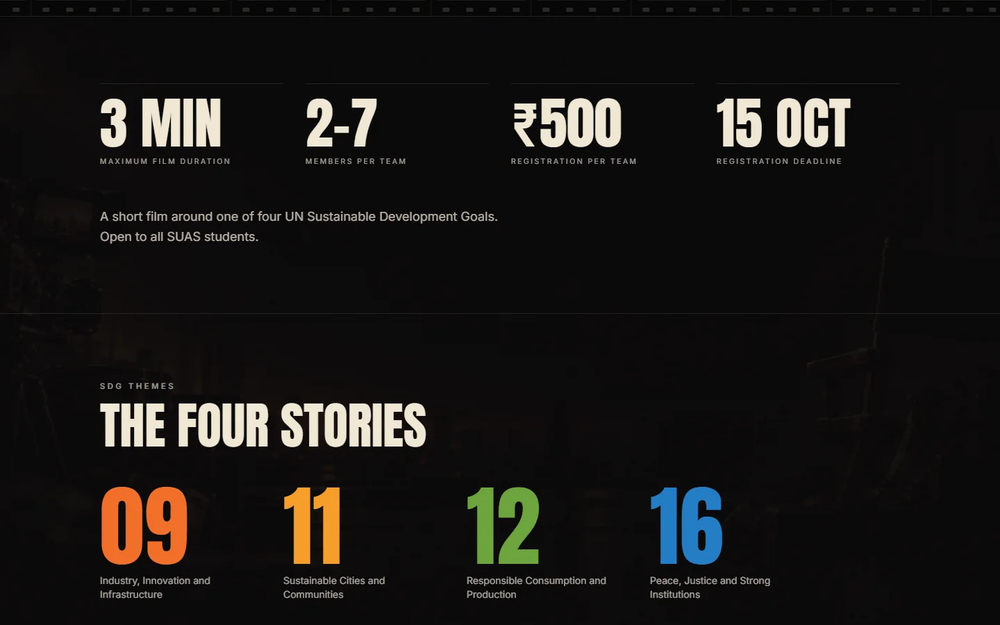 | 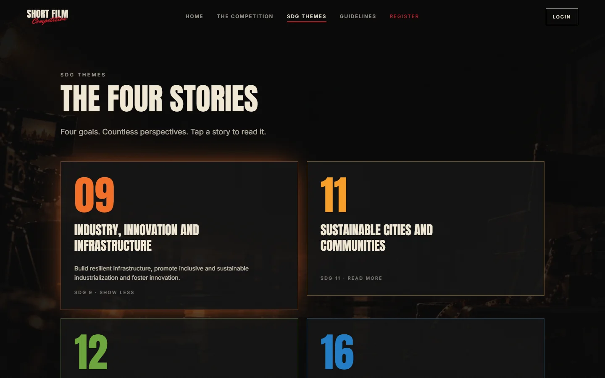 |

| Guidelines | Login |
|---|---|
| 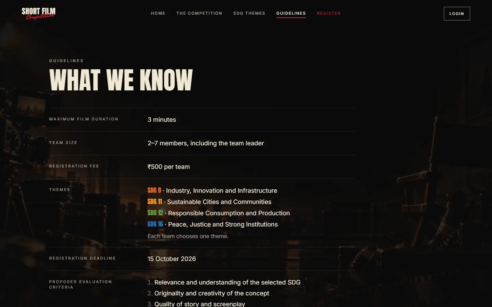 | 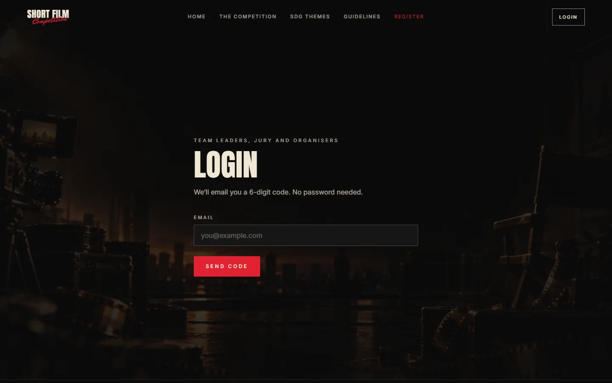 |

| Registration: team details | Registration: payment |
|---|---|
| 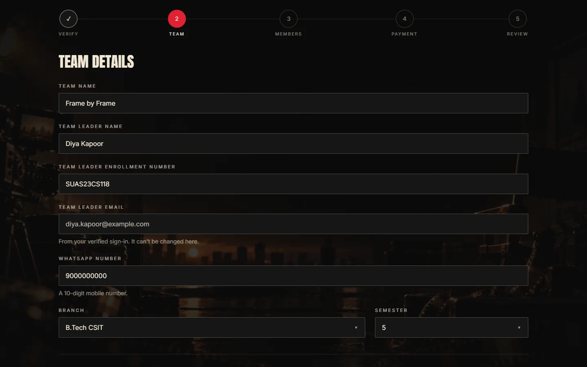 | 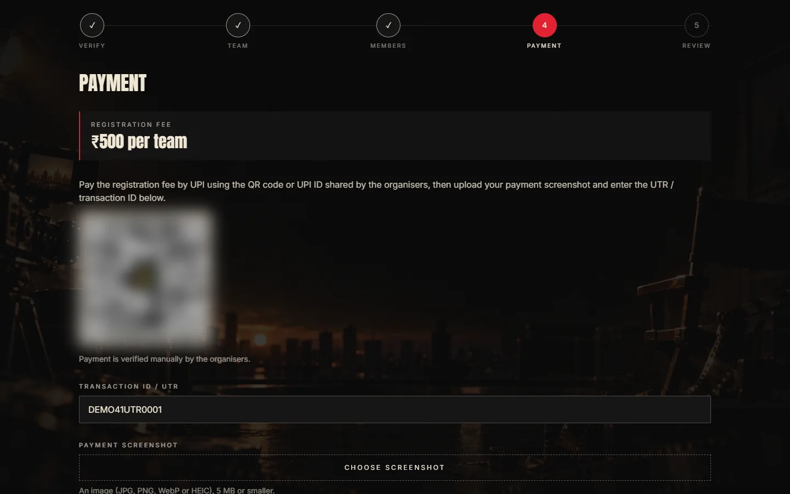 |

| Team dashboard |
|---|
| 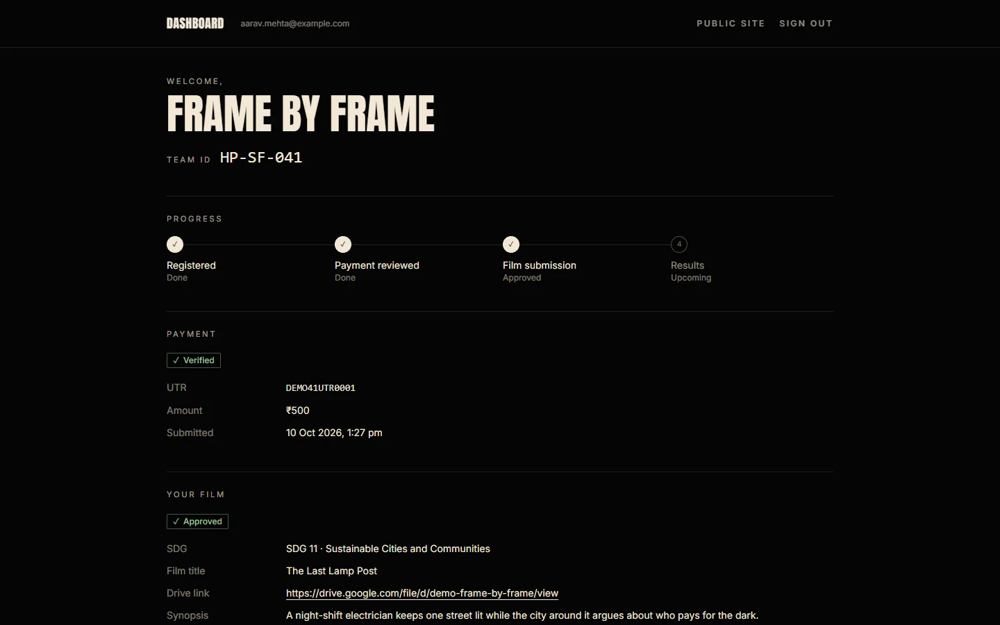 |

### Admin

- Overview counts for teams, payments, films and evaluations.
- Searchable, filterable team table with CSV export.
- Payment review queue: check the screenshot against the UTR, then verify or reject with a reason.
- Film review: mark under review, approve, or reject with a note.
- Lock or unlock a team's editing.
- Judging setup: locations, jury accounts, and team-to-location assignment.
- Event settings editor: deadline, fee, team size, open or closed switches, payment instructions.
- Per-team scoring view with every juror's scores, sums and averages.

| Overview | Payment review queue |
|---|---|
| 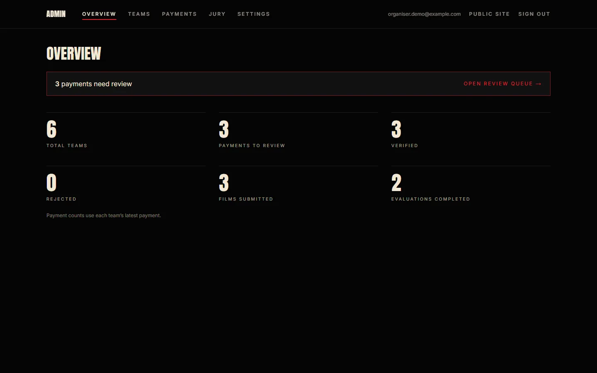 | 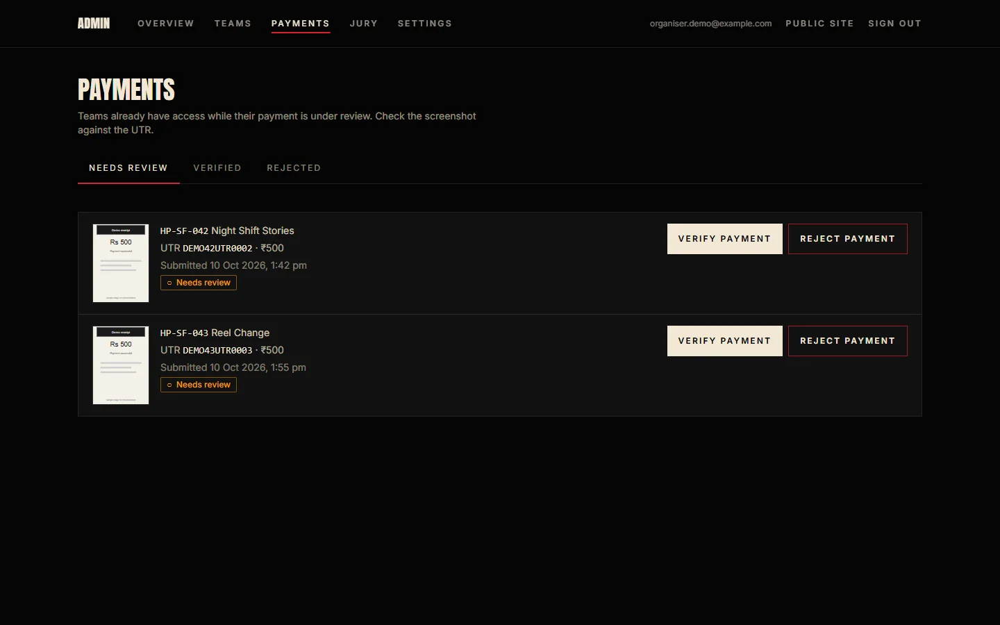 |

| Team evaluations |
|---|
| 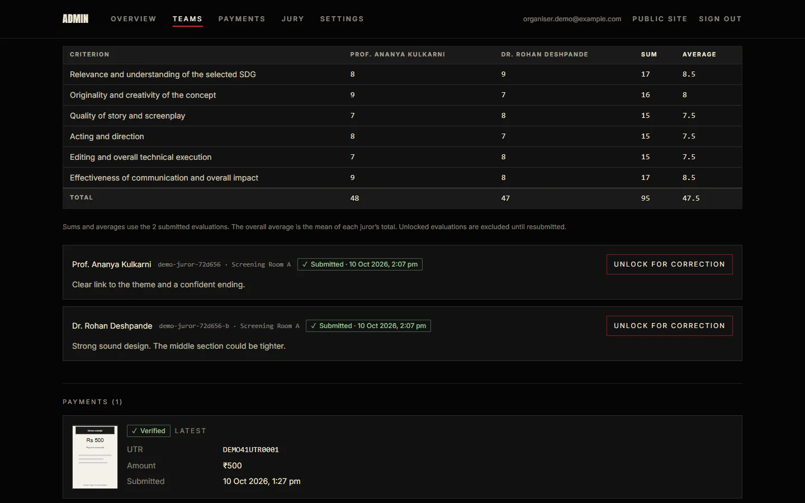 |

### Jury

- Separate sign-in with a jury ID and password set by the organisers.
- A queue of approved films for the juror's own location only.
- A focused scoring screen: film details, one score per criterion, an optional comment.
- A review step before final submission. Submitted scores are locked.
- Organisers can unlock a single evaluation for correction.

| Queue | Scoring |
|---|---|
| 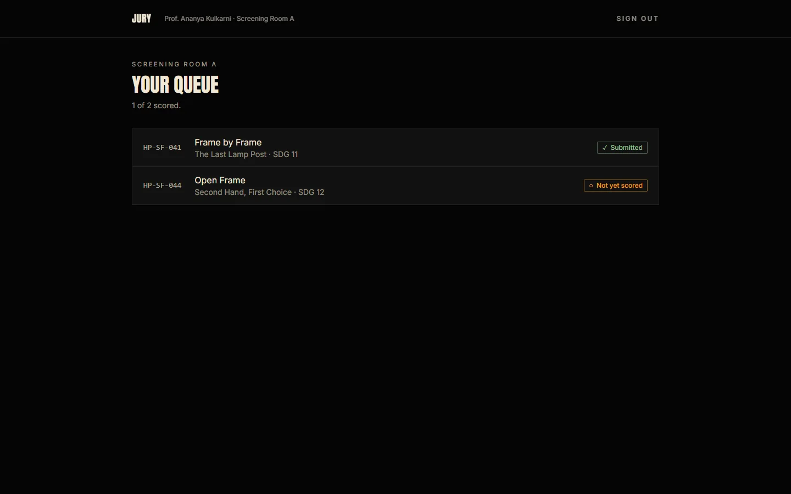 | 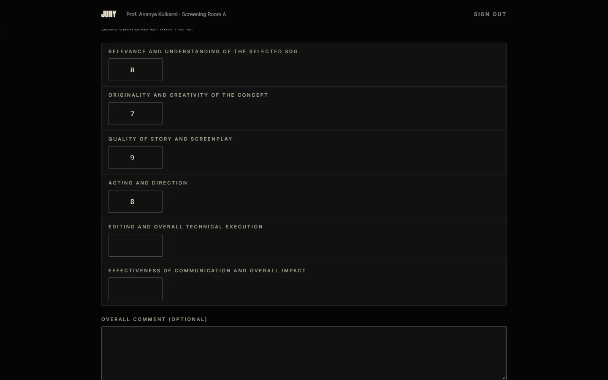 |

### On a phone

Most teams arrive from the poster's QR code, so every screen is designed for a phone first.

| Home | Registration | Dashboard | Jury scoring |
|---|---|---|---|
|  | 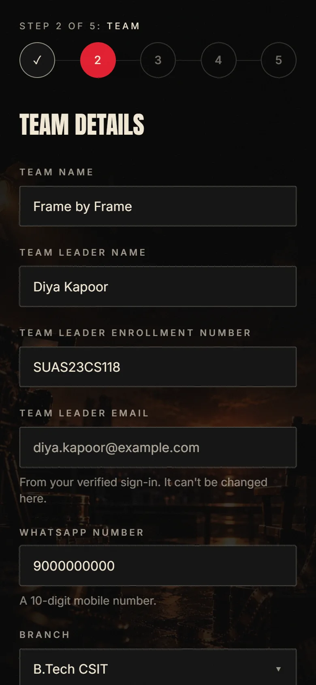 | 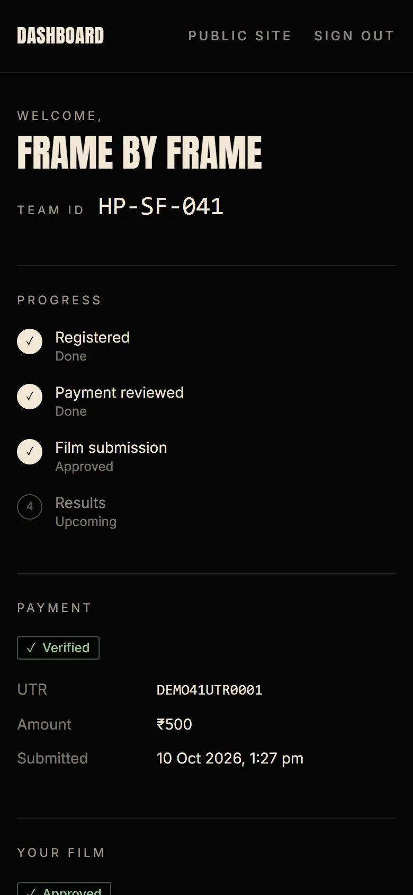 | 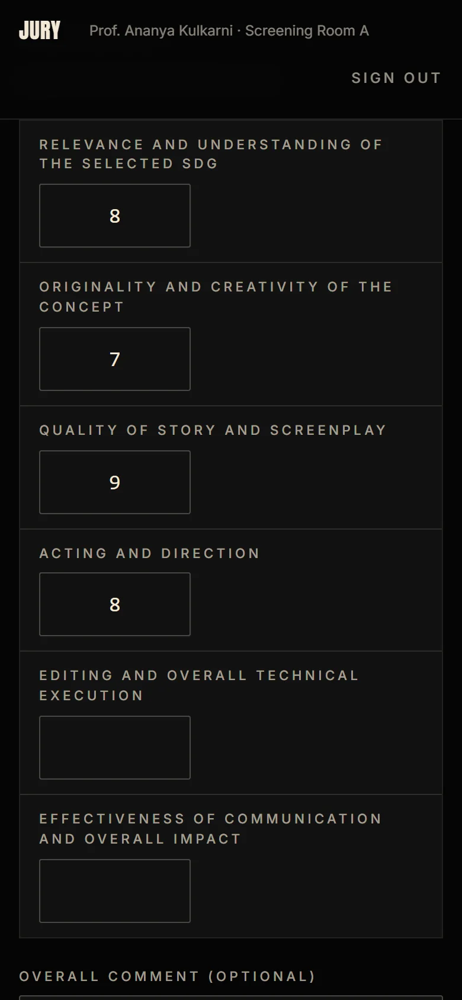 |

All screenshots use fictional demo teams, jurors and payment details.

## How it works

1. **Registration.** The team leader verifies their email with a one-time code, enters team details and members (team size limits come from settings), and submits a payment reference with a screenshot. Each team gets an ID such as `HP-SF-027`.
2. **Optimistic payment review.** A registered team has full access straight away while its payment shows "Needs review". An organiser later verifies or rejects it against the screenshot and UTR. A rejected team sees the reason and can resubmit; old payment records are kept as history.
3. **Film submission.** When submissions are open, the team picks its SDG and submits a title, synopsis and a Google Drive link. Films are never uploaded to the site. Organisers approve the film or reject it with a note, and the team can resubmit.
4. **Panel judging.** Organisers create locations (rooms or online panels), assign teams to them, and create jury accounts tied to a location. Panels judge in parallel: each juror works through their own queue and scores each criterion from 1 to 10.
5. **Scoring.** For every team, organisers see each juror's scores, the sum and average per criterion, each juror's total, and the overall average across jurors.

Event values such as the fee, deadline, team size and criteria are stored as settings and edited from the admin area, not hardcoded.

## Tech stack

| Layer | Technology |
|---|---|
| Framework | Next.js 16 (App Router, server components, server actions) |
| Language | TypeScript |
| Styling | Tailwind CSS 4 with custom design tokens |
| Motion | Framer Motion |
| Validation | Zod, shared by client and server |
| Database | PostgreSQL on Neon |
| ORM | Prisma 7 with the Neon serverless adapter |
| Participant and admin auth | Better Auth, email one-time code |
| Jury auth | Username and password with scrypt hashing and server-side sessions |
| Email | Nodemailer over SMTP |
| File storage | Vercel Blob (payment screenshots only) |
| Hosting | Vercel |

## Architecture

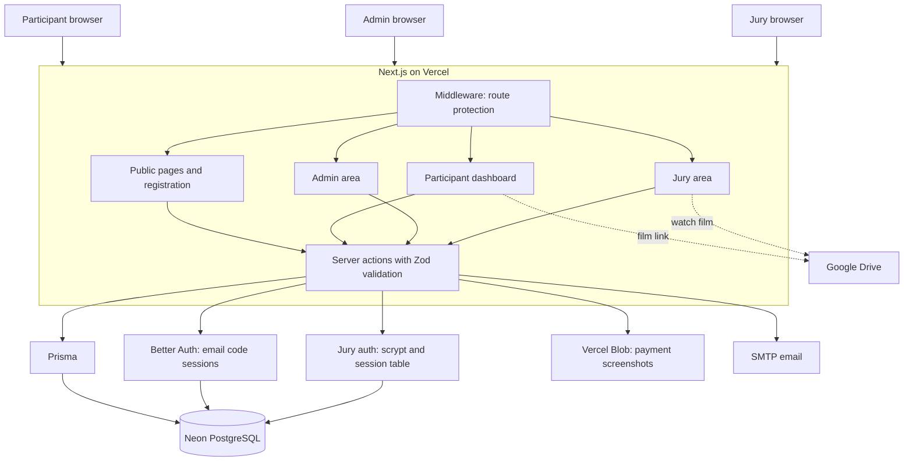

## Security

- **Role-based access.** Middleware protects `/dashboard`, `/admin` and `/jury`. Every page and server action also checks the role itself, and participant actions are scoped to the signed-in leader's own team.
- **Separate jury authentication.** Jury accounts are independent of participant and admin accounts. Passwords are hashed with scrypt, session tokens are stored only as hashes, and deactivating an account signs it out everywhere.
- **Least exposure for jurors.** A juror sees only approved films from teams in their location. They never see payment data, team members, or other jurors' scores.
- **Server-side validation.** Every input is validated again on the server with Zod. The registration fee and scoring scale are read from settings on the server, never trusted from the browser.
- **Rate limiting.** Sign-in codes, jury sign-in attempts and screenshot uploads are rate limited.
- **Upload checks.** Payment screenshots are limited to image types and 5 MB, and a submitted screenshot link must belong to the signed-in user's own upload folder.
- **Locked scores.** Jury scores are final on submit. Only an organiser can unlock a single evaluation, and resubmitting locks it again.

## Getting started

### Prerequisites

- Node.js 20 or newer
- A PostgreSQL database (Neon is recommended: one pooled and one direct connection string)
- An SMTP account for sending sign-in codes
- A Vercel Blob store for payment screenshots

### Install

```bash
git clone https://github.com/SuyashVJain/shortfilm_hult.git
cd shortfilm_hult
npm install
cp .env.example .env
```

### Environment variables

Fill these in `.env`. Never commit that file.

| Variable | Purpose |
|---|---|
| `DATABASE_URL` | Pooled database connection, used at runtime |
| `DIRECT_URL` | Direct database connection, used for migrations |
| `BETTER_AUTH_SECRET` | Secret for signing sessions |
| `BETTER_AUTH_URL` | Base URL of the site |
| `SMTP_USER` | SMTP username |
| `SMTP_PASS` | SMTP password or app password |
| `EMAIL_FROM` | Sender name and address |
| `ADMIN_EMAIL` | Email of the first admin, created by the seed |
| `BLOB_READ_WRITE_TOKEN` | Vercel Blob token |

### Database

```bash
npx prisma migrate deploy   # apply migrations
npm run db:seed             # default settings and the first admin
```

### Run

```bash
npm run dev
```

Open http://localhost:3000. The admin signs in at `/login` with the `ADMIN_EMAIL` address. Jurors sign in at `/jury/login` with accounts created under Admin, then Jury.

### Useful scripts

| Script | What it does |
|---|---|
| `npm run dev` | Start the development server |
| `npm run build` | Production build |
| `npm run typecheck` | TypeScript check |
| `npm run lint` | ESLint |
| `npm run db:generate` | Regenerate the Prisma client |
| `npm run db:migrate` | Create and apply a migration in development |
| `npm run db:seed` | Seed default settings and the first admin |
| `npm run db:studio` | Open Prisma Studio |

## Project structure

```
.
├─ app/
│  ├─ (public)/            home, competition, sdgs, guidelines, register, login
│  ├─ (participant)/       dashboard and its actions
│  ├─ (admin)/admin/       overview, teams, payments, jury, settings
│  ├─ (jury)/jury/         login, queue, scoring
│  └─ api/                 auth handler, screenshot upload
├─ components/
│  ├─ cinema/              backdrop, grain, loader and other atmosphere
│  ├─ ui/                  buttons, form fields, table, badges, stepper
│  ├─ site/                navigation, footer, contact
│  ├─ home/  sdg/  register/  dashboard/  admin/  jury/
├─ lib/
│  ├─ auth.ts              participant and admin auth
│  ├─ jury-auth.ts         jury accounts and sessions
│  ├─ guards.ts            role checks
│  ├─ settings.ts          typed event settings with defaults
│  ├─ scoring.ts           scoring schema, sums and averages
│  ├─ validation/          shared Zod schemas
│  └─ db.ts, mailer.ts, storage.ts, team-code.ts
├─ prisma/
│  ├─ schema.prisma
│  ├─ migrations/
│  └─ seed.ts
├─ docs/                   event facts, design system, architecture, flows
├─ public/                 backdrops and logos
└─ middleware.ts
```

## Roadmap

- Results page and winner selection per award category
- An admin view of all film submissions in one queue
- Editing SDG themes, award categories and evaluation criteria from settings
- Email notifications for film review decisions
- Private storage for payment screenshots
- Average score column in the teams table and CSV export

## Credits

Organised by **Hult Prize @ SUAS**, Symbiosis University of Applied Sciences, Indore.

- **Dhruvi Namdeo**, Campus Director
- **Suyash Vasal Jain**, Deputy Campus Director
